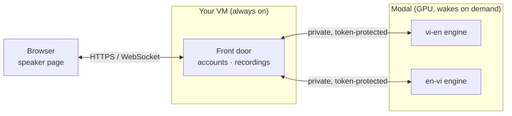

# MedComms

**A research prototype for real-time Vietnamese ⇄ English medical speech
translation**, developed in the
[VinUni Medical Translation project](https://vinuni-medical-mt.github.io/)
at VinUniversity.

MedComms explores how speech recognition and machine translation can support
conversations between Vietnamese-speaking patients and English-speaking
clinicians. While someone speaks, a browser page shows the transcription and
its translation, updating as the sentence goes on. It is used for demos and
research; it has not been evaluated for, or deployed in, clinical care.

What the prototype does:

- Translates **Vietnamese → English and English → Vietnamese** at the same
  time, one direction per device.
- Lets the speech recognition and translation models be chosen per direction
  on the server, without code changes, for experiments (see [Models](#models)).
- Runs the models on rented GPUs ([Modal](https://modal.com)) only while they
  are in use; a small VM serves the page.
- Keeps each demo session's audio, transcripts, translations, models used and
  the participants' ratings and corrections together, for later analysis.

> **Recording.** Demo sessions are recorded (from Start to Stop) on the
> project's server. Tell participants, and get their consent, before
> recording them.

---

## How it fits together



- **Front door** (`medcomms front`, on the VM): serves the speaker page, signs
  users in, records each session and relays audio to the engines.
  It needs no GPU and installs in seconds.
- **Engine** (`medcomms engine`, on Modal): every switched-on direction runs
  in one container on one shared GPU. Per direction, a pipeline of three
  processes — speech segmentation
  ([Silero VAD](https://github.com/snakers4/silero-vad)), recognition and
  translation — sends the growing utterance for transcription every second, so
  the text improves as the sentence goes on; a pause finalises it.
- **You** turn each direction on and off, and choose its models and the
  machine, from your laptop with `medcomms cloud`.

Setting it up: **[docs/DEPLOY.md](docs/DEPLOY.md)** (step by step, no prior
server experience needed).

---

## Everyday use

```bash
medcomms cloud start vi-en                    # turn on Vietnamese → English
medcomms cloud start en-vi --asr MODEL        # English → Vietnamese, chosen model
medcomms cloud status                         # what is on, with which models
medcomms cloud stop all                       # turn everything off
```

The engine is woken when a user signs in or starts a conversation, and
sleeps after 5 minutes without one (configurable); while asleep it costs
nothing. Starting or stopping a direction redeploys the engine, which ends any
conversation in progress, so do it between demos.

### Accounts

New users create their own account on the page with the **sign-up code**
(`MEDCOMMS_SIGNUP_CODE` on the VM), then sign in with their username and
password. Each sees the history of their own sessions, on any device, and can
rate and correct their sentences there. On the VM, as the `medcomms` user:

```bash
medcomms users list                  # accounts, created, last signed in
medcomms users add user01          # create one yourself; prints a password
medcomms users reset user01        # new password (signs them out)
medcomms users disable user01      # block sign-in, keep recordings
medcomms sessions list               # sessions, newest first, with a summary
medcomms sessions export out.zip     # files + sessions.csv + sentences.csv
medcomms sessions delete <session>   # permanently, after confirming
```

`sessions list` and `export` take `--user`, `--since` and `--until`.

| `cloud start` option | Initially | |
|---|---|---|
| `--asr MODEL` | by size | speech recognition model for this direction (see below) |
| `--mt MODEL` | built-in default | translation model for this direction |
| `--model-size` | `large` | size of the default models |
| `--gpu` | `L4,A10` | Modal GPU type, or several in order of preference (used when the first has no capacity) |
| `--cpu` | `2` | CPU cores |
| `--memory` | `16` | memory in GiB |
| `--idle-minutes` | `5` | sleep after this long without a conversation |

The machine options are shared by all directions and keep their last value
when left out.

### Models

The models are chosen per direction by whoever operates the deployment, with
`medcomms cloud start <direction> --asr MODEL --mt MODEL`, and are kept in the
deployment's settings, not in this repository (`medcomms cloud status` shows
them). Any Hugging Face model of a supported kind can be used:

- **ASR:** Whisper size names (`tiny` … `large-v3`, `turbo`) and CTranslate2
  conversions (`*faster-whisper*`) run on faster-whisper. Repositories that
  ship their own CTC code (an `asr/` package and a `.pt` checkpoint) run
  with that code. Any other Hugging Face speech recognition
  model runs on the transformers pipeline.
- **Translation:** any Hugging Face sequence-to-sequence model, or a PEFT
  (LoRA) adapter, which is merged into its base model. For mBART-50 based
  models the languages are set automatically. A
  fine-tuned model saved without tokenizer files uses the default model's
  tokenizer for its direction.
- Check each model's licence: some are for non-commercial research only.

### Recordings

On the VM, under `/var/lib/medcomms/sessions/`, one folder per session:

```
2026-11-12/093015-vi-en-3f9a1c2b7d4e/
    session.json     user, direction, start and end time, models used
    audio.opus       what was said (~14 MB per hour; plays in any media player)
    results.jsonl    every partial and final result, in order
    feedback.jsonl   ratings (1–5) and corrections per sentence; latest wins
```

No IP addresses or browser details are stored. Audio recording pauses (text
continues) if the disk has less than 2 GB free.

---

## Development

```bash
# macOS: brew install opus
#        export DYLD_LIBRARY_PATH="/opt/homebrew/opt/opus/lib:$DYLD_LIBRARY_PATH"
# Ubuntu: sudo apt-get install libopus0
python -m venv .venv && source .venv/bin/activate
make install

make dev-light   # everything locally with tiny models → http://localhost:8000
make dev         # the same with the real (small) models
medcomms dev --light --accounts   # with sign-in (sign-up code: dev)
make check       # lint + tests
```

`make dev` runs an engine and the front door on your computer — no cloud and
no cost; recordings go to `./data`. The page (`medcomms/web/`) is plain HTML,
CSS and JavaScript with no build step: edit and reload.

**Workflow:** work on a branch and open a pull request; tests run
automatically. Merging into `main` deploys to the live demo once the tests
pass (see [docs/DEPLOY.md](docs/DEPLOY.md#updates-and-rollback)).

```
medcomms/
├── cli.py             the `medcomms` command
├── front/             front door: page server, accounts, recordings
├── engine/            translation engine: segmentation, ASR, MT
├── cloud/             Modal app and `medcomms cloud`
└── web/               the speaker page
deploy/vm-setup.sh     one-time VM setup
```

### Engine protocol

`WS /ws/<direction>` on an engine (or, signed in, on the front door). The
client sends binary messages, each one Opus packet of 40 ms of 16 kHz mono
audio. The engine sends JSON: first
`{"type": "info", "direction", "asr", "mt"}`, then one message per update:
`partial` while a sentence is being spoken (its text may still change), and
one `final` when it is finished:

```json
{
  "type": "final",
  "timestamp": "2026-05-25T12:58:35.259085+00:00",
  "transcription": "Chào buổi sáng, anh thấy trong người thế nào?",
  "translation": "Good morning, how are you feeling?"
}
```

The front door adds `{"type": "ready", "session": "<id>"}` once the engine is
connected, and an `id` to each final result, which ratings refer to. Each direction serves one conversation at a time; a second one is
closed with code `1013` (try again later).

---

## Research

MedComms is a prototype of the
[VinUni Medical Translation project](https://vinuni-medical-mt.github.io/)
(Robust Vietnamese-English Clinical and Educational Medical Translation).
The project's related datasets:

- **MedEV** — a Vietnamese-English parallel corpus for the medical domain,
  about 360K sentence pairs.
  [Paper](https://aclanthology.org/2024.lrec-main.784/) ·
  [Dataset](https://huggingface.co/datasets/nhuvo/MedEV)
- **ViMedCSS** — 34 hours of Vietnamese medical code-switching speech
  (16,576 utterances, each with English medical terms).
  [Paper](https://arxiv.org/abs/2602.12911) ·
  [Dataset](https://huggingface.co/datasets/tensorxt/ViMedCSS)
- **En-ViMedNER** — an English-Vietnamese parallel biomedical corpus with UMLS
  semantic-type annotations (44,892 sentence pairs).
  [Paper](https://arxiv.org/abs/2608.29890) ·
  [Dataset](https://huggingface.co/datasets/nhuvo/En-ViMedNER) ·
  [Project page](https://vinuni-medical-mt.github.io/EnViMedNER/)

If you use these resources, please cite:

```bibtex
@inproceedings{vo-etal-2024-improving,
  title     = "Improving {V}ietnamese-{E}nglish Medical Machine Translation",
  author    = "Vo, Nhu and Nguyen, Dat Quoc and Le, Dung D. and Piccardi, Massimo and Buntine, Wray",
  booktitle = "Proceedings of the 2024 Joint International Conference on Computational Linguistics, Language Resources and Evaluation (LREC-COLING 2024)",
  month     = may,
  year      = "2024",
  address   = "Torino, Italia",
  publisher = "ELRA and ICCL",
  url       = "https://aclanthology.org/2024.lrec-main.784/",
  pages     = "8955--8962"
}

@inproceedings{nguyen-etal-2026-vimedcss,
  title     = "{V}i{M}ed{CSS}: A {V}ietnamese Medical Code-Switching Speech Dataset {\&} Benchmark",
  author    = "Nguyen, Tung X. and Vo, Nhu and Nguyen, Giang Son and Hoang, Duy Mai and Huynh, Chien Dinh and Jauregi Unanue, I{\~n}igo and Piccardi, Massimo and Buntine, Wray and Le, Dung D.",
  booktitle = "Proceedings of the Fifteenth Language Resources and Evaluation Conference",
  month     = may,
  year      = "2026",
  address   = "Palma de Mallorca, Spain",
  publisher = "ELRA Language Resource Association",
  url       = "https://aclanthology.org/2026.lrec-1.445/",
  doi       = "10.63317/58uwrquo3znb",
  pages     = "5657--5665"
}

@inproceedings{vo-etal-2026-en,
  title     = "{E}n-{V}i{M}ed{NER}: An {E}nglish-{V}ietnamese Parallel Biomedical Corpus with {UMLS} Semantic Type Annotations",
  author    = "Vo, Nhu and Nguyen, Phuong and Le, Nu Uyen Phuong and Jauregi Unanue, I{\~n}igo and Le, Dung D. and Piccardi, Massimo and Buntine, Wray",
  booktitle = "Findings of the {A}ssociation for {C}omputational {L}inguistics: {EMNLP} 2026",
  month     = oct,
  year      = "2026",
  address   = "Budapest, Hungary",
  publisher = "Association for Computational Linguistics",
  url       = "https://aclanthology.org/2026.findings-emnlp.2392/",
  doi       = "10.18653/2026.findings-emnlp.2392",
  pages     = "51397--51418"
}
```

---

## Acknowledgments

Developed in the VinUni Medical Translation project by the College of
Engineering and Computer Science and the College of Health Sciences,
VinUniversity.

The streaming pipeline began from [live-translation](https://github.com/AbdullahHendy/live-translation)
by Abdullah Hendy (MIT). MedComms builds on
[Hugging Face Transformers](https://github.com/huggingface/transformers),
[faster-whisper](https://github.com/SYSTRAN/faster-whisper),
[Silero VAD](https://github.com/snakers4/silero-vad), and
[Opus](https://opus-codec.org/).

## License

MIT — see [LICENSE](LICENSE).
